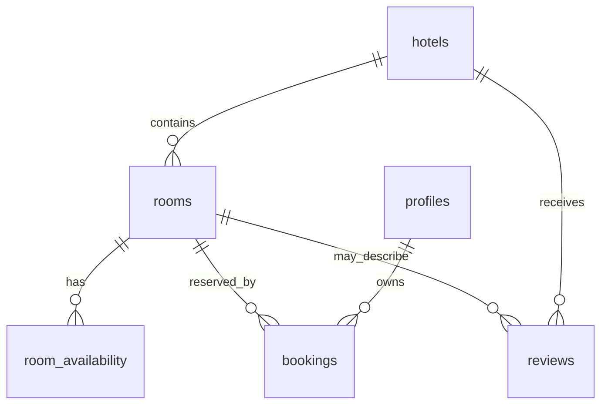

# StayEasy backend

## Data model



`profiles` extends Supabase Auth users. Hotels contain rooms; one availability row represents one room and calendar date. A booking stores the confirmed room, hotel, dates, guest details, and server-calculated prices.

## Access control

RLS is enabled on all six public tables. Anonymous visitors can read active hotels/rooms, availability, and reviews. Signed-in users can read and safely edit only their own profile, read only their own bookings, and create only unverified reviews under their own identity. They cannot directly create bookings or set booking totals/status.

Admins are determined only by `public.profiles.role = 'admin'` through the `public.is_admin()` security-definer helper; no email or client-controlled flag grants authority. The `profiles_role_allowed` constraint permits only `user` and `admin`. New Auth users get a `user` profile via `auth.users` trigger. To bootstrap the first administrator, create and verify the account normally, then run once in the Supabase SQL editor as a trusted database administrator:

```sql
update public.profiles set role = 'admin' where id = '<auth-user-uuid>';
```

Never expose service-role/secret credentials in Flutter. Flutter uses only the publishable client key; privileged operations belong in controlled database functions or backend services.

## Booking and cancellation

`create_booking(room_id, check_in, check_out, guest_count, guest_name, guest_email, guest_phone)` derives the caller from `auth.uid()`, locks the active room/hotel and every `[check_in, check_out)` availability row, verifies stock, calculates nightly price/subtotal/tax/discount server-side, decrements inventory, and inserts a unique `SE-...` code atomically. Taxes are `subtotal / 6` rounded to two decimals; the demo discount is up to ₹500 so totals never go below zero. Missing or sold-out dates fail the entire transaction, preventing overbooking.

`cancel_booking(booking_id)` is authenticated and ownership-scoped. It locks the booking and its nights, restores inventory exactly once, and changes `confirmed` to `cancelled`. Repeating a completed cancellation is idempotent.

## Demo seed

Run `supabase/seed.sql` after migrations (for example `supabase db reset` in a local linked environment, or execute it in the Supabase SQL editor for the remote demo project). It uses stable UUIDs and upserts 4 hotels, 12 rooms, October 2026 availability including sold-out dates, and 16 null-user demo reviews. Reviews span October, nearby months/seasons, older stays, hotel/room levels, verification states, and helpfulness values for deterministic ranking tests.
